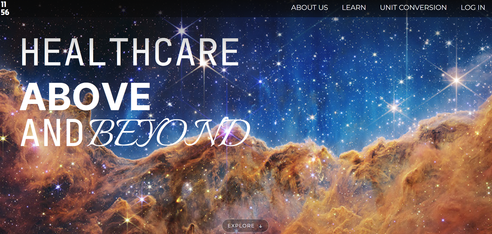
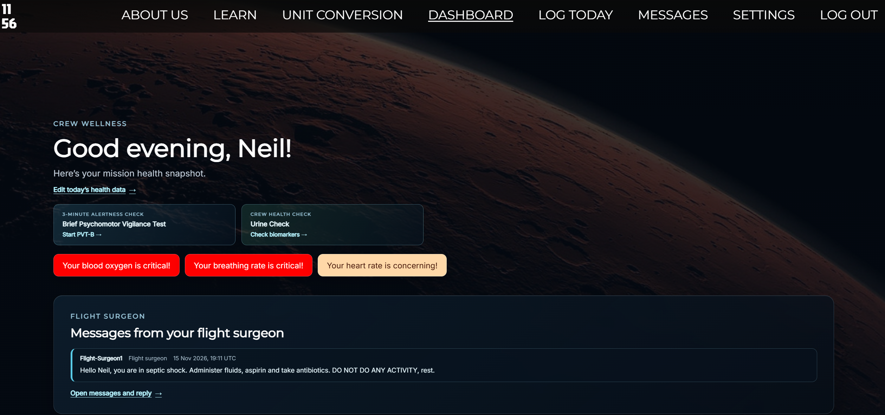
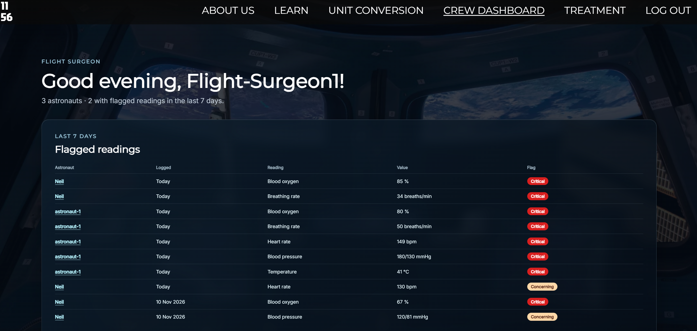
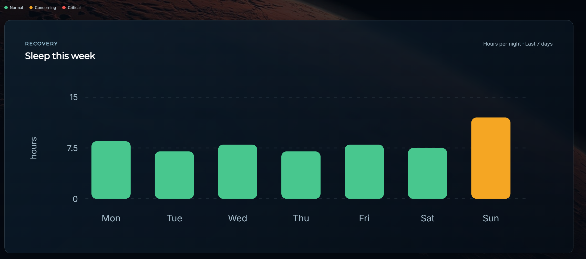

# 11:56 by Astronomads
       

*NASA Space Apps Challenge London 2026*

## 🍃 [View live demo](https://project1-kbp72xbpi-astronomads.vercel.app/)

## 🚀 [View NASA Space Apps Challenge Team](https://www.spaceappschallenge.org/2026/find-a-team/astronomads2/)

## Website Test Accounts:
### 🧑‍⚕️ Flight Surgeon
> Username: `Flight-Surgeon1`
>
> Password: `flightsurgeon`

----
### 🧑‍🚀 Astronaut
> Username: `Neil`
> 
> Password: `OneGiantLeap`

----
### 💻 How to register an account
An Invite Code is required so only Astronauts and Flight Surgeons can create an account. Here are the invite codes you can use to test it:

**🧑‍⚕️ Flight Surgeon:** `654321`

**🧑‍🚀 Astronaut:** `123456` 

## Screenshots

## Tools
 

## Artificial Intelligence Usage
  
