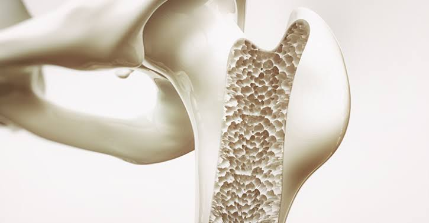

# Bone Health 

Author: Richard Roe

Published: 14th November 2026

----

Bone is constantly remodelled: osteoclasts break down old and damaged bone tissue, while osteoblasts build new bone.

In microgravity, this balance is disrupted. Without the normal mechanical load of gravity, bone resorption by osteoclasts outpaces bone formation, leading to rapid bone loss. As a result, astronauts' bones are weaker after a mission, putting them at higher risk of fractures from activities that would not normally cause injury. Weight-bearing bones such as the hips and spine no longer need to support the body's weight, so on average they lose 1–1.5% of their density per month during four-to-six-month missions.

*Inner structure of a femur, Source: https://encrypted-tbn0.gstatic.com/images?q=tbn:ANd9GcSqgXd4pZUKkxEPozU5TrrzqUJ2CbW7dhRlATA0prs3Zu1cgq5yb_68EG6h&s=10*

### Precautions

*Bone scans:* Dual-energy X-ray absorptiometry (DXA) scans are carried out before and after spaceflight to measure bone mineral density [9].

*Daily exercise:* Astronauts exercise for around two hours per day [6]. This includes the Advanced Resistive Exercise Device (ARED), which mimics weightlifting in microgravity [10].

*3D imaging:* Peripheral quantitative computed tomography (pQCT), used in studies such as TBone, examines the internal microarchitecture of bones.

> Testing for structure: 

Urine and Blood Tests:
### Urine biomarkers

*C-telopeptide (CTX) and N-telopeptide (NTX):* Type I collagen makes up most of the organic matrix of bone. When osteoclasts break down bone, this collagen is destroyed, releasing C-terminal and N-terminal telopeptide fragments, which are excreted in the urine. During spaceflight, urinary collagen breakdown products have been measured at around twice their preflight levels [11].

*Hypercalciuria (high calcium in urine):* As bone is broken down, stored calcium is released into the bloodstream and then filtered out by the kidneys into the urine. This increases the risk of kidney stones, which can cause severe pain (renal colic), blood in the urine (haematuria), infection that may lead to sepsis (a life-threatening response in which the immune system damages the body's own organs), and hydronephrosis (swelling of the kidney due to a build-up of urine), which can lead to kidney damage or failure.

### Preventing kidney stones

- *Potassium citrate:* an oral alkalising agent; citrate binds to calcium in the urine, preventing it from forming crystals.
- *Exercise (ARED):* loading the skeleton reduces bone loss, and therefore the amount of calcium released.
- *Bisphosphonates:* drugs that suppress osteoclast activity. Combined with ARED exercise, they have been shown to prevent hip bone loss in astronauts [10].
- *Hydration:* drinking more dilutes the urine, so stone-forming minerals are less concentrated.
- *Low-sodium diet:* high sodium intake increases extracellular fluid volume, so the kidneys reabsorb less sodium to excrete the excess. Because sodium and calcium are reabsorbed in parallel, less calcium is reabsorbed too, and more is lost in the urine, worsening hypercalciuria.

> Sources:
> 1. National Institutes of Health (2023) - [Bone Health and Osteoporosis](https://www.niams.nih.gov/health-topics/bone-health-and-osteoporosis) [Accessed 14th November 2026]
> 2. NASA (n.d.) Risk of Spaceflight-Induced Bone Changes. Available at: https://www.nasa.gov/reference/risk-of-spaceflight-induced-bone-changes/ (Accessed: 15 November 2026).
> 3. Sibonga, J. et al. (2019) 'Resistive exercise in astronauts on prolonged spaceflights provides partial protection against spaceflight-induced bone loss', Bone, 128, 112037. doi: 10.1016/j.bone.2019.07.013.
> 4. Smith, S.M. et al. (1998) 'Collagen cross-link excretion during space flight and bed rest', Journal of Clinical Endocrinology & Metabolism, 83(10), pp. 3584–3591.
