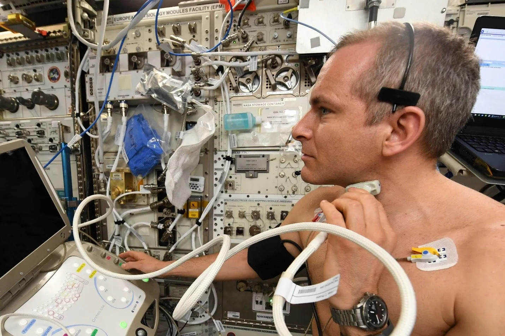

# Cardiovascular Health

Published: 15th November 2026

----
Outside Earth's atmosphere, *microgravity* is experienced by astronauts. This is the effect of weightlessness as the ISS continuously orbits the Earth. In microgravity, *deconditioning* of the cardiovascular system happens from a decrease in hydrostatic pressure gradients (this is the rate at which fluid pressure increases with vertical depth). Without gravity pulling blood towards the lower body, bodily fluids shifts upwards from the legs and the abdomen towards the heart and head [1].

Upon entering orbit, approximately 2 litres of fluid shifts from the legs towards the thorax and head [2]. This distends the internal jugular veins [3] and causes *facial oedema* (fluid accumulation in facial tissue) [1]. The *central baroreceptors* (detects changes in blood pressure) interpret the extra fluid in the thorax as *hypervolaemia* (fluid overload). This was traditionally thought to trigger increased renal fluid excretion [4]; however, in-flight studies suggest that reduced fluid intake plays a larger role [5]. Thus, blood plasma volume lowers by 10–15% [6].

As the heart doesn't pump against a 1G hydrostatic column (The pressure exerted by a fluid column under standard, 9.81N gravity) any more, *myocardial* (heart) workload decreases, leading to *myocardial atrophy* [1]. Left ventricular mass has been shown to fall by around 12% after spaceflight [7], while the *stroke volume* (amount of blood pumped out from the ventricle) also decreases [6].

This affects blood vessels too, after 6 months in space, carotid artery stiffness increases; This is comparable to 10 to 20 years of normal ageing on Earth [8].

*Chronic unloading* (prolonged reduction of mechanical load on tissues n the body) in space blunts the sensitivity of both carotid and aortic baroreceptors, since they don't have to counteract gravity [6]. Due to this, the *baroreflex* (body reaction to pressure changes) can't produce an appropriate vasoconstrictive response (narrowing of blood vessels) or *chronotropic responses* (increase in heart rate). This could cause light-headedness, *postural tachycardia* (abnormally high heart rate on standing) or *presyncope* (feeling close to fainting) [1,6].

*CSA astronaut David Saint-Jacques performs an ultrasound for the Vascular Echo experiment aboard the International Space Station. Source: Canadian Space Agency/NASA (NASA, 2023). https://www.nasa.gov/wp-content/uploads/2020/01/1_david-saint-jacques-vescular.jpg*

>## References
>[1] NASA (2023) *Cardiovascular Health in Microgravity*. Available at: https://www.nasa.gov/missions/station/cardiovascular-health-in-microgravity/ (Accessed: 15 November 2026).
> 
> [2] NASA (n.d.) *Ensuring Astronaut Health*. Available at: https://www.nasa.gov/?p=207552 (Accessed: 15 November 2026).
> 
> [3] Arbeille, P. *et al.* (2021) 'Lower body negative pressure reduces jugular and portal vein volumes and counteracts the elevation of middle cerebral vein velocity during long-duration spaceflight', *Journal of Applied Physiology*, 131(3), pp. 1080–1087. Available at: https://pmc.ncbi.nlm.nih.gov/articles/PMC8461809/ (Accessed: 15 November 2026).
> 
> [4] Williams, D. *et al.* (2009) 'Acclimation during space flight: effects on human physiology', *Canadian Medical Association Journal*, 180(13), pp. 1317–1323. doi: 10.1503/cmaj.090628.
> 
> [5] Olde Engberink, R.H.G. *et al.* (2023) 'The kidney, volume homeostasis and osmoregulation in space: current perspective and knowledge gaps', *npj Microgravity*, 9, 29. doi: 10.1038/s41526-023-00268-1.
> 
> [6] Silburn, A. (2025) 'Counteracting microgravity: preserving cardiovascular health in low earth orbit', *Military Medical Research*, 12, 53. doi: 10.1186/s40779-025-00642-y.
> 
> [7] Perhonen, M.A. *et al.* (2001) 'Cardiac atrophy after bed rest and spaceflight', *Journal of Applied Physiology*, 91(2), pp. 645–653. doi: 10.1152/jappl.2001.91.2.645.
> 
> [8] Hughson, R.L. *et al.* (2016) 'Increased postflight carotid artery stiffness and inflight insulin resistance resulting from 6-mo spaceflight in male and female astronauts', *American Journal of Physiology – Heart and Circulatory Physiology*, 310(5), pp. H628–H638.
