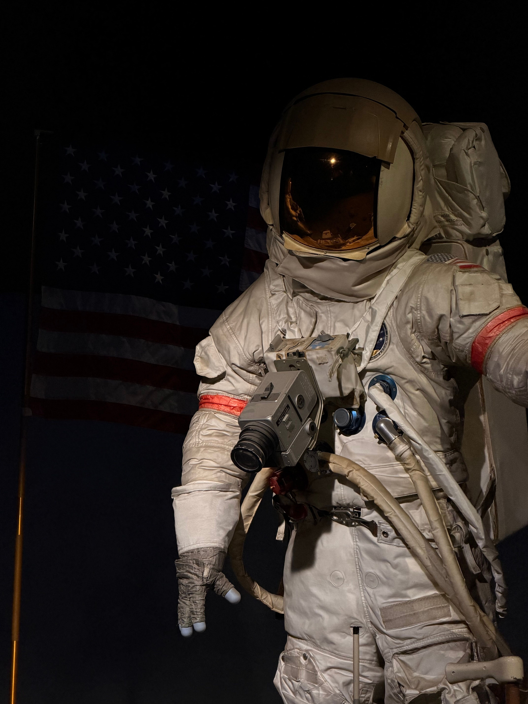

# Immune System

Published: 15th November 2026

----

In space, the immune system of the astronauts are inherently at risk, due to constant exposure to radiation, poor sleep, and microgravity in space, which is when astronauts experience weightlessness and free fall. The changes in the astronauts' immune system often causes allergies and activates dormant viruses.
Many details of how spacelflight affects the immune system are still unknown, and our software provides a platform for astronauts to track their immune health through logging their symptoms and recording results of blood and urine samples, which also helps scientists conduct experiments and have a better understanding of the space environment.

*An astronaut in space, Source: https://www.pexels.com/photo/astronaut-in-space-suit-with-american-flag-39483014/*

## Risks
Different factors work together to compromise the immune system of astronauts in space. For example, radiation through solar energetic particles and galactic cosmic rays damages the DNA of cells, leading to weakened immune responses to diseases. The microgravity causes the cells to be in free fall, which causes stem cells to be unable to repair damages caused by radiation as well as they should. Sleep deprivation also leaves the astronauts' bodies to be vulnerable to microbial infections and inflammation.

## Experiments
Scientists have conducted a variety of experiments to investigate changes to the astronauts' immune system in space. For example, in the Artemis II mission, blood and saliva samples of the astronauts are collected before, during and after the mission, to study how stress hormones, cells and viruses change during spaceflight. It was found out that the varicella-zoster virus which causes shingles is often reawakened in space, which can cause painful rashes, although many astronauts do not have any symptoms.

## Sources:
> 1. NASA. (2024). Risk of Altered Immune System Responses - NASA. [online] Available at: https://www.nasa.gov/reference/risk-of-altered-immune-system-responses/ [Accessed 15 Nov. 2026].
> 2. Garbarino, S., Lanteri, P., Bragazzi, N.L., Magnavita, N. and Scoditti, E. (2021). Role of sleep deprivation in immune-related disease risk and outcomes. Communications Biology, [online] 4(1). doi:10.1038/s42003-021-02825-4.
> 3. NASA. (2025). Immune biomarkers - NASA. [online] Available at: https://www.nasa.gov/reference/immune-biomarkers/ [Accessed 15 Nov. 2026].
> 4. NASA (2009). What is Microgravity? - NASA. [online] NASA. Available at: https://www.nasa.gov/centers-and-facilities/glenn/what-is-microgravity/ [Accessed 15 Nov. 2026].
>5. Wake Forest University School of Medicine. (2025). Space travel carries risks to immune system health. [online] Available at: https://school.wakehealth.edu/research/institutes-and-centers/wake-forest-institute-for-regenerative-medicine/awards-honors-and-media-coverage/space-travel-carries-risks-to-immune-system-health [Accessed 15 Nov. 2026].
> 6. Anon, (2021). Scientists probe how long-term spaceflight alters immunity - NASA. [online] Available at: https://www.nasa.gov/missions/station/scientists-probe-how-long-term-spaceflight-alters-immunity/ [Accessed 15 Nov. 2026].