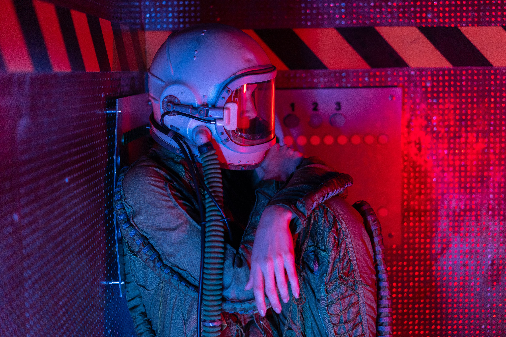

# Mental Health 

Published: 15th November 2026

----
### Risk of Cognitive and Behavioural Changes due to Psychiatric Disorders

Spending time in space leads to confinement and isolation. This results in decrements in cognitive function, which may not affect the crew immediately but pose great risk in the future (NASA, 2025) [1]. There is an estimated 0.22 per astronaut mission incidence of depression and anxiety (Slack et al., 2016) [2].\

*A lonely astronaut, Source: https://www.pexels.com/zh-tw/photo/7660827/

## Causes

- **Sleep Restriction:** Degrades motor and vigilance speed, causes mental fatigue and heightens stress (Nasrini et al., 2020) [3].
- **Environmental and Habitat Changes:** Confinement within a restricted environment, persistent noise from life support systems and environment control, altered lighting cycles, and a lack of terrestrial sensory stimulation (Schneider et al., 2010; Palinkas, 2007) [4][5].
- **Brain Structural Changes:** Fluid shifts in the brain caused by a lack of gravity (fluid is shifted upwards towards the head) (Koppelmans et al., 2016) [6].
- **Psychosocial and Interpersonal Pressures:** Separation from close ones, high workloads, and repetition of tasks over a multi-month to multi-year period (Palinkas, 2007) [5].
- **Radiation:** Memory impairment, anxiety, and depression (Cherry et al., 2012) [7] (harmful when combined with a lack of sleep). Terrestrial radiation — low Linear Energy Transfer (gamma rays and X-rays) — differs from Space Radiation, which is dominated by Galactic Cosmic Rays depositing dense tracks of ionisation energy; this distinction arises from the shielding effect of Earth's atmosphere (Cucinotta et al., 2013) [8]. HZE particles cause a myriad of different effects on the body (Wieg et al., 2024) [9].
- **Medicines:** SSRIs for depression/anxiety, short-acting anxiolytics (to reduce anxiety), and antipsychotics for acute behavioural emergencies (Kutz et al., 2024) [10].

> Sources:
> 1. NASA (2025) Risk of Adverse Cognitive or Behavioral Conditions and Psychiatric Disorders. Houston, TX: NASA Human Research Program, Behavioral Health and Performance. Available at: https://www.nasa.gov/directorates/esdmd/hhp/behavioral-health-risk (Accessed: 15 November 2026).

> 2. Slack, K.J., Shea, C., Leveton, L.B., Barger, L.K., Rooney, B. and Whitmire, A.M. (2016) Behavioral Health and Performance Element: Evidence Report. NASA Human Research Program. Houston, TX: National Aeronautics and Space Administration. (NASA Technical Report 20160004365).

> 3. Nasrini, J., Ebert, A., Winter, S., Mulavara, A.P., Cohen, H.S., Peters, B., Bloomberg, J.J. and Seidler, R.D. (2020) 'Cognitive Performance During Confinement and Sleep Restriction Analogous to Long-Duration Spaceflight', Frontiers in Physiology, 11, p. 394. doi: 10.3389/fphys.2020.00394.

> 4. Schneider, S., Askew, C.D., Diehl, J. and Mierau, A. (2010) 'Exercise as a countermeasure to psycho-physiological deconditioning during confinement', Behavioural Brain Research, 211(2), pp. 208–214. doi: 10.1016/j.bbr.2010.03.013.

> 5. Palinkas, L.A. (2007) 'Psychosocial issues in long-term space flight: overview', Gravitational and Space Biology Bulletin, 20(2), pp. 11–19.

> 6. Koppelmans, V., Bloomberg, J.J., De Dios, Y.E., Wood, S.J., Reuter-Lorenz, P.A., Kofman, I.S., Riascos, R.F., Mulavara, A.P. and Seidler, R.D. (2016) 'Brain structural plasticity with spaceflight', npj Microgravity, 2, p. 16001. doi: 10.1038/npjmgrav.2016.1.

> 7. Cherry, J.D., Liu, B., Frost, J.L., Lemere, C.A., Williams, J.P., Olschowka, J.A. and O'Banion, M.K. (2012) 'Galactic Cosmic Radiation Leads to Cognitive Impairment and Increased Aβ Plaque Accumulation in a Mouse Model of Alzheimer's Disease', PLoS ONE, 7(12), p. e53275. doi: 10.1371/journal.pone.0053275.

> 8. Cucinotta, F.A. (2014) 'Space radiation risks for astronauts on deep space missions', in Handbook of Cosmic Radiation. Springer. (Cucinotta, F.A., Kim, M.Y. and Ren, L. (2013) Evaluating Shielding Approaches to Reduce Space Radiation Cancer Risks. NASA TM-2013-217985.)

> 9. Wieg, L.J., Garrett, A., Britten, R.A. and Davis, C.M. (2024) 'Cognitive Effects of Simulated Galactic Cosmic Radiation Are Similar in Male and Female Rats', Frontiers in Neuroscience, 18. doi: 10.3389/fnins.2024.1393717.

> 10. Kutz, C.J., Kerstman, E. and Blue, R. (2024) 'Ketamine for the Management of Acute Behavioral Emergencies in Spaceflight', Aerospace Medicine and Human Performance, 95(8). (NASA Technical Report 20240012115.)
